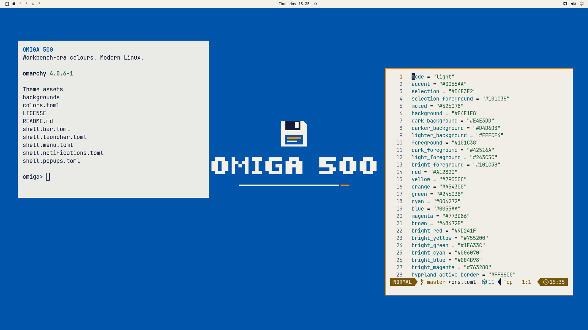

# Omiga 500

A Workbench-era-inspired light theme for Omarchy: cobalt blue, warm ivory, ink-black text and orange details. Original pixel lettering and diskette artwork. Modern Linux, old-school character.

## Status

User-approved release, tested on Omarchy 4.0.6-1. Not an Amiga emulator or a pixel-identical recreation of Workbench. The project name has not undergone formal trademark clearance.

## Included

- Original center-safe 3840×2160 wallpaper.
- A coordinated light palette for applications generated by Omarchy.
- Ivory shell bar, blue menu selections and orange active window borders.
- Supported shell color overrides only; existing panel placement, fonts and layout are retained.

No installers, hooks, plugins, ROMs, system files or bundled fonts. The disk on the wallpaper is decorative, not a clickable desktop icon. The theme does not add classic window gadgets or change window-manager behavior.

## Install

```bash
omarchy-theme-install https://github.com/rogunlimited-hub/omarchy-omiga-500-theme
```

Or use Omarchy's theme installer and paste that repository URL. Applying the theme changes the active palette and wallpaper. Record your previous theme and background first; selecting them again rolls back the appearance.



## Compatibility and preview

Target: Omarchy 4.0.6. Tested in an isolated clean Omarchy 4.0.6-1 VM: normal theme application, terminal, Neovim, native menu and a theme-switch round trip via Catppuccin passed; Hyprland reported no configuration errors. All 19 installed application templates generated with no unresolved tokens, and TOML/JSON parsed successfully. No user plugins were installed. Older Waybar/Walker releases are not tested. `preview.png` is a real 1920×1080 desktop screenshot. Windows were manually arranged and terminal font sizes adjusted for the screenshot; these presentation choices are not imposed by the theme.

The wallpaper has no crop-sensitive outer frame. Its central artwork was checked with center-cover crops at 16:10, 16:9, 21:9 and 32:9. That is not a promise of automatic support for every display geometry.

## Rights and attribution

Original theme configuration and artwork: Copyright (c) 2026 Roger Østebø. Licensed under MIT (see LICENSE). The five-row lettering was drawn for this project; no proprietary font was extracted or included.

An independent, unofficial fan project. Not affiliated with or endorsed by Amiga, its rights holders, or Omarchy. Amiga and Workbench are names belonging to their respective rights holders and are used descriptively only. No original logos, icons, fonts, sounds, screenshots or operating-system assets are distributed. Original creation and this notice do not constitute legal or trademark clearance.
